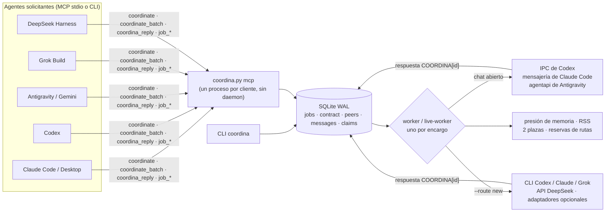

# Coordina

[English](README.md) · **Español**

**Coordina el trabajo *entre* modelos de IA: pásale una tarea al chat de Claude, Codex o Gemini que ya tienes abierto, y recupera la respuesta por ID de encargo aunque te reconectes.**

Coordina es un intermediario local de encargos entre agentes de IA en macOS. Un agente (Claude Code, Codex, Antigravity/Gemini, Grok Build…) delega trabajo en **la conversación ya abierta de otro agente** —que conserva su historial, modelo y permisos— y recupera después la respuesta correlacionada desde una cola SQLite durable. Entrega, respuesta y ejecución se registran **por separado**, y una entrega incierta nunca se reenvía sola.

Python 3.9+ solo con biblioteca estándar · sin daemon · sin puertos de red · MIT.

**Modelos que Coordina puede coordinar:** Codex, Claude, Gemini (vía Antigravity), Grok, DeepSeek, GLM, Nemotron y Qwen: cualquier modelo alcanzable desde un mismo entorno (un computador, un servidor, un enjambre de máquinas) mediante una app de escritorio, una CLI o una API.

> 🏁 **Hito (noviembre de 2026):** Coordina ha sido probado coordinando **9 modelos** —Codex, Claude, Gemini (vía Antigravity), Grok, DeepSeek, GLM, Nemotron, Qwen y Meta AI—, con encargos completados registrados para cada uno. 
>
> *Nota:* el conteo es histórico, respaldado por encargos completados en el registro. La ruta de Meta AI (un puente local a su app) está **deshabilitada en esta versión** —Coordina rechaza `meta-ai` como destino—, así que no se ofrece como conexión disponible.


> **Versión preliminar pública (2.3.14).** Solo macOS. Los transportes hacia chats abiertos usan interfaces **no documentadas** de Codex de escritorio y Antigravity que pueden romperse con cualquier actualización: ver [Versiones probadas](#versiones-probadas) y [Límites](#límites). [English](README.md)

<!-- AQUÍ VA EL GIF DE DEMO (guion de 45 s en docs/PRESENTATION.md) -->

## Inicio rápido

```sh
git clone https://github.com/Rocamu/coordina-ai-models.git && cd coordina-ai-models
python3 install.py          # registra el MCP y la skill en Codex y Claude Code (respalda cada archivo que toca)
```

Luego, dentro de **Claude Code**:

```text
/coordina con Codex: revisa el diff de este repo y señala el cambio más riesgoso.
```

Coordina lista las conversaciones de Codex abiertas en esa carpeta, eliges una, la tarea aparece **en ese chat** y la respuesta vuelve a Claude marcada `COORDINA[<id>]`. Cierra Claude, ábrelo de nuevo y la respuesta sigue ahí:

```sh
coordina wait <job_id> --seconds 45
```

Desde **Codex**: `$coordina con Claude: …` · Desde **Antigravity**: `Coordina con Claude para …`

## Instalar con un agente de IA

Puedes pedirle a Codex, Claude Code o Grok que instale Coordina en tu Mac. Pega esto en el agente, desde una carpeta vacía:

```text
Instala Coordina desde https://github.com/Rocamu/coordina-ai-models en este Mac.
1. Comprueba: macOS, `python3 --version` 3.9 o superior, y que `codex` y `claude` estén en el PATH
   (install.py se detiene si falta alguno). Dime qué falta en vez de instalarlo.
2. Clona el repo y ejecuta `python3 -m unittest discover -s tests`. Detente si falla alguna prueba.
3. Antes de instalar, lee install.py y lista cada archivo que va a crear o modificar en mi carpeta
   de usuario. Espera mi OK.
4. Ejecuta `python3 install.py` (o `python3 install.py --antigravity` si solo quiero el plugin de Antigravity).
   No agregues --auto-approve salvo que te lo pida. Muéstrame la carpeta de respaldo que imprime.
   Si falla, se deshace solo: muéstrame el error, corrige la causa conmigo y vuelve a ejecutarlo.
5. Verifica con `~/.local/bin/coordina status` e infórmame la versión y los destinos que detecta.
6. No envíes encargos a otros modelos hasta que te lo pida; empieza con uno en modo consulta.
```

Una instalación correcta deja: el runtime en `~/Library/Application Support/Coordina/runtime/`, el estado en `~/.local/share/coordina/` (con `backups/<fecha>/`), el lanzador `~/.local/bin/coordina`, el servidor MCP `coordina` registrado en Codex y Claude Code, copias de la skill para Codex, Claude y, si existen, Antigravity y `~/.dsh/skills`, y `Coordina-Claude.zip` para el catálogo de Claude/Cowork. Reconecta o reinicia tus apps de agentes para que carguen el MCP.

## Qué obtienes

- **Entrega en conversaciones abiertas** (Codex de escritorio, Claude Code incluida su app, Antigravity) con recibo, en vez de lanzar un proceso sin contexto.
- **Cola durable:** cada encargo es una fila SQLite; la respuesta se recupera por `job_id` tras reconexiones o reinicios.
- **Entrega, respuesta y ejecución por separado:** `completed` significa *llegó una respuesta*, no «el trabajo está verificado».
- **Sin reenvío automático ni sustituciones silenciosas:** una entrega incierta queda en `delivery_unknown`; un chat ocupado o ausente se espera o se informa, nunca se reemplaza a escondidas por una sesión nueva.
- **Idempotencia:** el mismo `request_id` devuelve el mismo encargo.
- **Consulta o edición:** `consult` pide solo análisis; `edit` usa el sandbox propio de cada CLI.
- **Guarda de memoria de macOS:** admisión según `kern.memorystatus_vm_pressure_level` y vigilancia de RSS; lo pesado se declara (`--workload heavy`).
- **Modo lote, reservas de rutas y ejecutores nuevos** cuando ningún chat abierto sirve (`--route new`).

## Cuando un encargo no queda `completed`

| Estado | Significa | Qué hacer |
|---|---|---|
| `waiting_destination` | El chat destino está ocupado | Esperar; Coordina entrega cuando quede libre |
| `delivery_unknown` | No se puede probar que el mensaje llegó | Revisar el chat destino. **No reenviar a ciegas.** Si no llegó, enviar de nuevo con otro `request_id` |
| `response_pending` | Entregado, sin respuesta aún (o la app destino espera una aprobación en su interfaz) | Aprobar o rechazar tú en la app destino; `coordina wait <id>` o un `coordina_reply` posterior completan el mismo encargo |
| `held` / `delivery_refused` | Los controles del receptor lo retuvieron o rechazaron | Respetarlo |
| `session_busy` / `session_unavailable` | Chat fijado ocupado o desconectado antes de entregar | `coordina resume <id> --expected-revision N` (solo en estos estados) |
| `blocked_memory` | Presión de memoria alta | Reintentar luego |

## Versiones probadas

| Transporte | Verificado con | Interfaz |
|---|---|---|
| Codex de escritorio | Paquete ChatGPT/Codex, 16-10-2026 | Socket IPC interno `~/.codex/ipc/ipc.sock` (no documentado) |
| Claude Code | Claude Code 2.1.304, 20-10-2026 | Mensajería entre sesiones documentada |
| Antigravity | Antigravity 2.24.0, 17-10-2026 | `agentapi` + métodos internos del servidor de lenguaje (no documentados) |
| Ejecutores nuevos | Codex CLI, Claude Code CLI, Grok Build CLI | CLI públicas |

## Integraciones

- **Claude:** MCP de Claude Code + skill global; Claude Desktop / Cowork con el ZIP del plugin (`/coordina`).
- **Codex / ChatGPT de escritorio:** `codex mcp add` + plugin de Codex (`$coordina`).
- **Antigravity (Gemini):** plugin en `~/.gemini/config/plugins/coordina` (`python3 install.py --antigravity`) con `coordinate`, `coordinate_batch` y `coordina_reply` (y el resto), sujetas a las aprobaciones de Antigravity.
- **Grok Build:** servidor MCP en `~/.grok/config.toml` ([ejemplo](examples/grok-config.toml)); Grok también es destino de ejecutor nuevo.
- **DeepSeek Harness:** skill en `~/.dsh/skills/coordina/` si existe `~/.dsh/skills`; MCP stdio con `--client harness`.

**También: ejecutores sin interfaz (`--route new`)** — `codex`, `claude`, `grok` (CLI oficiales, `--model` / `--reasoning-effort` por encargo); `deepseek-official(-fast)` (API con libro de presupuesto, tope inicial US$10); `cowork` (chats de Claude.ai con `ui-receipt`). `qwen`: Qwen (código abierto) mediante un cliente de agente propio que configuras (`joker.cli` más un comando controlador de GPU `joker.qwenctl` en `config.json`); el modo lote apunta a esta ruta; probado con Qwen en una GPU remota. Adaptadores opcionales: `deepseek`, `glm`, `nemotron` (modelos gratuitos vía OpenCode) y `freellm` (endpoints gratuitos de NVIDIA vía proxy FreeLLM local).

## Referencia de la CLI

```sh
coordina status
coordina conversations codex --workspace /ruta/proyecto --task "Revisar el ayudante de medición"
coordina submit claude "Revisa docs/plan.md y lista riesgos" --workspace /ruta/proyecto --mode consult
coordina submit codex "Renderiza la vista previa" --workspace /ruta/proyecto --mode edit --workload heavy
coordina submit codex "Opinión fresca, sin historial" --workspace /ruta/proyecto --route new --rounds 1
coordina show ID | coordina wait ID --seconds 45 | coordina cancel ID
coordina reply ID CLAVE "respuesta final"
coordina resume ID --expected-revision 3
coordina lote qwen --workspace /ruta --tarea "tarea 1" --tarea "tarea 2"
```

`--workspace` obligatorio · `--mode consult|edit` · `--workload light|heavy` · `--route auto|existing|new` (`new` = ejecutor **sin memoria**) · `--rounds`, `--timeout` (hasta 900 s; 3600 s solo codex/new/1 ronda) · `--request-id`.

## Límites

- **Solo macOS.**
- **Interfaces no documentadas** de Codex de escritorio y Antigravity: pueden romperse con actualizaciones.
- **Token CSRF de Antigravity:** se lee del argumento `--csrf_token` del propio proceso de Antigravity en la lista de procesos (`ps`, mismo usuario, ejecutable del paquete) y solo se habla con `127.0.0.1`. Herramientas de seguridad de endpoints pueden marcar este patrón.
- **No es un sandbox del sistema operativo.**
- **Los mensajes de otro agente son entrada no confiable**; nunca equivalen a consentimiento ni amplían permisos. Coordina no concede aprobaciones de interfaz.
- **Sin garantía de exactamente una vez:** evita reenvíos *automáticos*, no puede probar que nadie reenvió a mano.
- **Las apps de escritorio deben estar abiertas.**
- **Interno en español primero** (descripciones de herramientas, errores, skill); traducción al inglés en curso.
- **Credenciales:** las CLI usan su propio inicio de sesión; los adaptadores de API (DeepSeek oficial, FreeLLM) leen claves que tú dejas en `~/.config/agent-ecosystem/secrets/`. Coordina no copia claves a su estado.
- **Instalador transaccional:** antes de escribir nada comprueba macOS, Python ≥ 3.9, `codex`/`claude` en el PATH, permisos de escritura y que los JSON de los clientes sean válidos; no usa la red. Si un paso falla o lo interrumpes, borra lo que creó y restaura lo que modificó; repetirlo es seguro.
- **Retención:** tareas, respuestas y transcripciones quedan en `~/.local/share/coordina/coordina.sqlite3` (`0600`) hasta que las borres; los respaldos del instalador en `~/.local/share/coordina/backups/`. Aún no hay purga automática.

## Aprobación de herramientas (segura por defecto)

Los ejecutores nuevos (`--route new`) **no** reciben aprobación automática de herramientas por defecto:

- **Codex CLI** corre `codex exec` en un sandbox `read-only` (`consult`) o `workspace-write` (`edit`), sin escalar permisos; nada fuera del sandbox se aprueba.
- **Claude Code CLI** corre con una lista explícita de herramientas (`Read, Glob, Grep`, más `Edit` limitado a la carpeta de trabajo en modo `edit`); lo demás se niega, no se aprueba.
- **Grok Build CLI** no tiene aprobaciones interactivas en modo sin interfaz, así que Coordina **rechaza** encargos a Grok salvo que actives la opción.
- El instalador **no** preaprueba en Codex las herramientas MCP de Coordina.

Para activarla (por ejemplo, para usar ejecutores Grok), elige una:

```bash
python3 install.py --auto-approve      # guarda "auto_approve": true en ~/.local/share/coordina/config.json
COORDINA_AUTO_APPROVE=1 coordina ...   # por proceso; COORDINA_AUTO_APPROVE=0 la fuerza apagada
```

Con la opción activada, Grok corre con `--always-approve` dentro de su perfil de sandbox `read-only` / `coordina-grok`, y Codex preaprueba las herramientas MCP de Coordina. Ver [SECURITY.md](SECURITY.md).

## Hoja de ruta / Limitaciones conocidas

- **Tu propio Qwen (planificado):** hoy un tercero no puede conectar su propio Qwen sin una conexión genérica a un servidor propio. La vía actual es el adaptador `joker` (alias `qwen`), que requiere un comando cliente que aportas tú (`joker.cli`, que habla el protocolo JSON del adaptador) y un comando controlador de GPU (`joker.qwenctl`) que Coordina llama antes de cada entrega. Un adaptador genérico para tu propio servidor (por ejemplo, un endpoint compatible con OpenAI) está planificado y todavía no está implementado. Qwen figura entre los modelos coordinados porque ya se coordinó, no porque hoy sea fácil conectarlo.

## Arquitectura



Archivos: `coordina.py` (MCP, CLI, cola, adaptadores, memoria), `live.py` (chats abiertos), `routing.py` (recibos de interfaz), `lifecycle.py` (contrato), adaptadores opcionales, `install.py`, `plugin/`. Detalle: [`docs/native-protocols.md`](docs/native-protocols.md).


## Lo que se ha coordinado con Coordina

- **Una revisión a tres modelos de este mismo repositorio:** Claude, Codex y Gemini (vía Antigravity) criticaron el paquete, el planteamiento y la presentación en modo consulta; ver [docs/DEBATE.md](docs/DEBATE.md).
- **Segundas opiniones entre proveedores:** Claude Code pidiéndole a un chat abierto de Codex revisar un diff, y al revés.
- **Trabajo masivo de texto en rutas con tope de gasto y gratuitas:** clasificación y redacción con DeepSeek, GLM y Nemotron.
- **Qwen:** Coordina ha coordinado Qwen; en ese caso, un modelo de código abierto que corre en una GPU remota.
- **Meta AI:** encargos respondidos mediante un puente local a la app de Meta AI (ruta deshabilitada en esta versión).
- **Ejecutores nuevos** con Codex, Claude Code y Grok cuando ningún chat abierto sirve.

## Comparación

Puentes Claude Code ↔ Codex, servidores MCP que lanzan CLI, herramientas de segunda opinión, buzones de agentes y paneles multiagente cubren partes de este espacio, varios con mucho más pulido, plataformas y usuarios. El foco de Coordina es más estrecho: **entrega en chats ya abiertos, entre proveedores, con respuestas recuperables y estados de entrega separados.** Notas con fuentes: [docs/COMPARISON.md](docs/COMPARISON.md).

## Créditos y licencia

Los transportes de escritorio de `live.py` se desarrollaron tomando como referencia [WebisityStudio/claude-codex-mcp-bridge](https://github.com/WebisityStudio/claude-codex-mcp-bridge) (MIT, © 2026 Tesla Major); aviso completo en [NOTICE](NOTICE) y [THIRD_PARTY_NOTICES.md](THIRD_PARTY_NOTICES.md). Creado por Rodrigo Castillo. Licencia [MIT](LICENSE).
