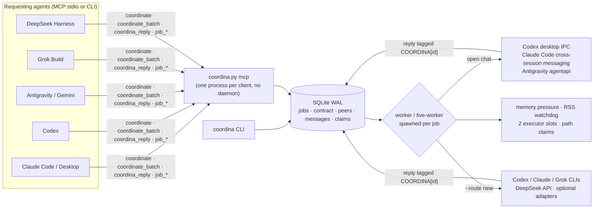

# Coordina

**English** · [Español](README.es.md)

**Coordinate work *between* AI models — hand a task to the Claude, Codex or Gemini chat you already have open, and get the reply back by job ID, even after you reconnect.**

Coordina is a local job broker for AI agents on macOS. One agent (Claude Code, Codex, Antigravity/Gemini, Grok Build…) delegates work to **another agent's already-open desktop conversation** — keeping that chat's history, model and permissions — and retrieves the correlated answer later from a durable SQLite queue. Delivery, response and execution are tracked **separately**, and an uncertain delivery is never re-sent automatically.

Python 3.9+ standard library only · no daemon · no network port · MIT.

**Models Coordina can coordinate:** Codex, Claude, Gemini (via Antigravity), Grok, DeepSeek, GLM, Nemotron and Qwen — any model that can be reached from the same environment (a laptop, a server, a swarm of machines) through a desktop app, a CLI or an API.

> 🏁 **Milestone (November 2026):** Coordina has been tested coordinating **9 models** — Codex, Claude, Gemini (via Antigravity), Grok, DeepSeek, GLM, Nemotron, Qwen and Meta AI — with completed jobs recorded for every one of them. 
>
> *Note:* the count is historical, backed by completed jobs in the job registry. The Meta AI route (a local bridge to its app) is **disabled in this release** — Coordina rejects `meta-ai` as a target — so it is not offered as an available connection.


> **Public preview (2.3.14).** macOS only. The open-chat transports use **undocumented** interfaces of the Codex desktop app and Antigravity that can break with any app update — see [Tested versions](#tested-versions) and [Limits](#limits). [Español](README.es.md)

<!-- DEMO GIF GOES HERE (see docs/PRESENTATION.md for the 45-second script) -->

## Quick start

```sh
git clone https://github.com/Rocamu/coordina-ai-models.git && cd coordina-ai-models
python3 install.py          # registers the MCP server + skill in Codex and Claude Code (backs up every file it touches)
```

Then, inside **Claude Code**:

```text
/coordina with Codex: review the diff in this repo and list the riskiest change.
```

Coordina lists the Codex conversations open for this folder, you pick one, the task appears **in that chat**, and the reply comes back to Claude tagged `COORDINA[<job id>]`. Close Claude, reopen it, and the reply is still there:

```sh
coordina wait <job_id> --seconds 45
```

From **Codex**: `$coordina with Claude: …` · From **Antigravity**: `Coordina with Claude to …`

## Install with an AI agent

You can ask Codex, Claude Code or Grok to set Coordina up on your own Mac. Paste this into the agent, from an empty folder:

```text
Install Coordina from https://github.com/Rocamu/coordina-ai-models on this Mac.
1. Check: macOS, `python3 --version` is 3.9 or newer, and both `codex` and `claude` are on PATH
   (install.py stops if either CLI is missing). Tell me what is missing instead of installing it.
2. Clone the repo and run `python3 -m unittest discover -s tests`. Stop if any test fails.
3. Before running the installer, read install.py and list every file it will create or modify
   in my home directory. Wait for my OK.
4. Run `python3 install.py` (or `python3 install.py --antigravity` if I only want the Antigravity plugin).
   Do not add --auto-approve unless I ask. Show me the backup folder it prints.
   If it fails, it rolls back by itself: show me the error, fix the cause with me, and run it again.
5. Verify with `~/.local/bin/coordina status` and report the version and the targets it sees.
6. Do not send any job to another model until I ask. Then start with a consult-mode job.
```

What a correct install leaves behind (all created by `install.py`): the runtime in `~/Library/Application Support/Coordina/runtime/`, state in `~/.local/share/coordina/` (with `backups/<timestamp>/`), the launcher `~/.local/bin/coordina`, the `coordina` MCP server registered in Codex and Claude Code, skill copies for Codex, Claude and (if present) Antigravity and `~/.dsh/skills`, and `Coordina-Claude.zip` for the Claude/Cowork plugin catalog. Reconnect or restart your agent apps afterwards so they load the new MCP server.

## What you get

- **Delivery into open conversations** — Codex desktop, Claude Code (incl. the desktop app) and Antigravity — with a receipt, instead of spawning a context-less process.
- **Durable queue** — every job is a SQLite row; replies are recovered by `job_id` after reconnects or client restarts.
- **Delivery, response and execution tracked separately** — `completed` means *a reply arrived*, not "the work was verified".
- **No automatic resend, no silent substitution** — an uncertain delivery becomes `delivery_unknown`; a busy or missing chat is reported or waited for, never quietly replaced by a new session.
- **Idempotency** — the same `request_id` returns the same job instead of spending quota twice.
- **Consult vs. edit** — `consult` asks for analysis only; `edit` maps to each CLI's own sandbox flags.
- **macOS memory guard** — admission by `kern.memorystatus_vm_pressure_level` and an RSS watchdog for light jobs; heavy jobs must be declared (`--workload heavy`).
- **Batch mode, path claims and fresh executors** when no open chat fits (`--route new`).

## When a job is not `completed`

| State | Meaning | What to do |
|---|---|---|
| `waiting_destination` | Target chat is busy | Wait; Coordina delivers when it is idle |
| `delivery_unknown` | Coordina cannot prove the message arrived | Open the target chat and check. **Do not resubmit blindly.** If it never arrived, submit again with a new `request_id` |
| `response_pending` | Delivered, no reply yet (or the target app is waiting for a UI approval) | Approve/deny in the target app yourself; `coordina wait <id>` or a later `coordina_reply` completes the same job |
| `held` / `delivery_refused` | The receiver's own controls kept or refused it | Respect it; adjust the receiver's settings if appropriate |
| `session_busy` / `session_unavailable` | Pinned chat busy/offline before any delivery | `coordina resume <id> --expected-revision N` (only for these states) |
| `blocked_memory` | macOS memory pressure too high | Retry later or free memory |

## Tested versions

| Transport | Verified against | Interface |
|---|---|---|
| Codex desktop (open chats) | ChatGPT/Codex desktop package, 2026-10-16 | Internal IPC socket `~/.codex/ipc/ipc.sock` (undocumented) |
| Claude Code (open sessions) | Claude Code 2.1.304, 2026-10-20 | Documented cross-session messaging |
| Antigravity (open chats) | Antigravity 2.24.0, 2026-10-17 | `agentapi` (sidecar CLI) + internal language-server methods (undocumented) |
| New executors | Codex CLI, Claude Code CLI, Grok Build CLI | Public CLIs |

On any unknown protocol shape Coordina reports the failure instead of improvising.

## Integrations

| Client | Connection | Notes |
|---|---|---|
| **Claude** | Claude Code MCP (user scope) + global skill; Claude Desktop / Cowork via plugin ZIP | `/coordina` |
| **Codex / ChatGPT desktop** | `codex mcp add` + Codex plugin (`plugin/.codex-plugin`) | `$coordina` |
| **Antigravity (Gemini)** | Plugin in `~/.gemini/config/plugins/coordina` (`python3 install.py --antigravity`) | Tools `coordinate`, `coordinate_batch`, `coordina_reply` (+ the rest), each subject to Antigravity's approval settings |
| **Grok Build** | MCP server entry in `~/.grok/config.toml` — see [`examples/grok-config.toml`](examples/grok-config.toml) | Grok is also a fresh-executor target |
| **DeepSeek Harness** | Skill copied to `~/.dsh/skills/coordina/` when `~/.dsh/skills` exists; MCP stdio with `--client harness` | Tools may appear as `mcp__coordina__*` |

### Also: headless executors (`--route new`)

| Target | Backend |
|---|---|
| `codex`, `claude`, `grok` | Codex CLI, Claude Code CLI, Grok Build CLI — per-job `--model` / `--reasoning-effort` (Grok requires the [tool auto-approval opt-in](#tool-approvals-safe-by-default)) |
| `deepseek-official`, `deepseek-official-fast` | DeepSeek API, text only, transactional budget ledger (default cap US$10) |
| `cowork` | Claude.ai / Cowork chats driven by the requesting agent's own UI tools, recorded with `ui-receipt` |
| `qwen` | Qwen (open source) through a self-hosted agent client you configure (`joker.cli` plus a GPU controller command `joker.qwenctl` in `config.json`). Batch mode (`coordinate_batch` / `lote`) targets this route. Tested with Qwen on a remote GPU |
| `deepseek`, `glm`, `nemotron` | Free models through the OpenCode desktop CLI (optional adapter) |
| `freellm` | NVIDIA free endpoints (Nemotron and others on an allow-list) through a local FreeLLM proxy (optional adapter) |

## CLI reference

```sh
coordina status
coordina conversations codex --workspace /path/to/project --task "Review the measuring helper"
coordina submit claude "Review docs/plan.md and list risks" --workspace /path/to/project --mode consult
coordina submit codex "Render the preview" --workspace /path/to/project --mode edit --workload heavy
coordina submit codex "Fresh opinion, no history" --workspace /path/to/project --route new --rounds 1
coordina show JOB_ID | coordina wait JOB_ID --seconds 45 | coordina cancel JOB_ID
coordina reply JOB_ID REPLY_KEY "final answer"
coordina resume JOB_ID --expected-revision 3
coordina lote qwen --workspace /path --tarea "task 1" --tarea "task 2"
```

| Option | Meaning |
|---|---|
| `--workspace` | Required. Project folder (`~/.local/share/coordina/intercambio` for ad-hoc questions) |
| `--mode consult\|edit` | Default `consult` |
| `--workload light\|heavy` | Declare renders, local models, builds, bulk processing as `heavy` (not inferred) |
| `--route auto\|existing\|new` | `auto` prefers open chats; `existing` pins one; `new` = fresh executor **with no memory** |
| `--rounds 1..4`, `--timeout` | Up to 900 s (3600 s only for `codex`, `route=new`, one round) |
| `--request-id` | Idempotency key |

MCP tools: `conversations`, `coordinate`, `coordinate_batch`, `coordina_reply`, `ui_receipt`, `job_wait`, `job_status`, `job_cancel`, `job_resume`, `job_export`, `output_check`, `bridge_status`, `peer_register`, `peer_send`, `peer_message_status`, `peer_inbox`, `peer_ack`, `paths_claim`, `paths_release`. Examples: [`examples/`](examples/).

## Limits

- **macOS only** (`fcntl`, `sysctl`, app-bundle paths, Unix sockets).
- **Undocumented interfaces** (Codex desktop IPC, Antigravity language-server methods) — expect breakage after app updates.
- **Antigravity CSRF token:** Coordina reads the `--csrf_token` argument of Antigravity's own process from the process list (`ps`, same user, app-bundle executable only) and talks only to `127.0.0.1`. Endpoint-security tools may flag this pattern.
- **Not an OS sandbox.** `consult`/`edit` are CLI permission flags and instructions, not isolation.
- **Agent messages are untrusted input** for the receiver; they never carry user consent or widen its permissions. Coordina never approves UI prompts.
- **No exactly-once guarantee.** Coordina avoids *automatic* resends; it cannot prove a human or agent did not resend.
- **Desktop apps must be running** for open-chat delivery. Cloud chats are reachable only through the `cowork` UI-receipt route.
- **Spanish-first internals:** tool descriptions, errors and the skill are currently in Spanish (English translation in progress).
- **Credentials:** CLI targets use each CLI's own login. API adapters (DeepSeek official, FreeLLM) read keys you place under `~/.config/agent-ecosystem/secrets/`. Coordina never copies keys into its state.
- **Data retention:** task text, replies and transcripts stay in `~/.local/share/coordina/coordina.sqlite3` (permissions `0600`) until you delete them; installer backups stay in `~/.local/share/coordina/backups/`. There is no automatic pruning yet.

## Tool approvals (safe by default)

Fresh executors launched with `--route new` do **not** get blanket tool auto-approval by default:

- **Codex CLI** runs `codex exec` in a `read-only` sandbox (`consult`) or `workspace-write` (`edit`), with no approval escalation; nothing outside the sandbox is approved.
- **Claude Code CLI** runs with an explicit tool allow-list (`Read, Glob, Grep`, plus `Edit` scoped to the workspace in `edit` mode); anything else is denied, not approved.
- **Grok Build CLI** has no interactive approvals in headless mode, so Coordina **refuses** Grok executor jobs unless you opt in.
- The installer does **not** pre-approve Coordina's own MCP tools in Codex.

To opt in (for example to use Grok executors), choose one:

```bash
python3 install.py --auto-approve      # persists "auto_approve": true in ~/.local/share/coordina/config.json
COORDINA_AUTO_APPROVE=1 coordina ...   # per process; COORDINA_AUTO_APPROVE=0 forces it off
```

With the opt-in, Grok executors run with `--always-approve` inside their `read-only` / `coordina-grok` sandbox profile, and Codex pre-approves Coordina's MCP tools. See [SECURITY.md](SECURITY.md).

## Roadmap / Known limitations

- **Bring your own Qwen (planned):** today a third party cannot connect their own Qwen without a generic connection to a self-hosted server. The current route is the `joker` adapter (alias `qwen`), which requires a client command you provide (`joker.cli`, speaking the adapter's JSON protocol) and a GPU controller command (`joker.qwenctl`) that Coordina calls before each delivery. A generic adapter for your own server (for example an OpenAI-compatible endpoint) is planned and not implemented yet. Qwen is listed among the coordinated models because it has been coordinated, not because connecting it is easy today.

## Architecture



| File | Role |
|---|---|
| `coordina.py` | MCP server (stdio JSON-RPC), CLI, SQLite queue, executor adapters, memory policy |
| `live.py` | Open-chat discovery, proposals and native delivery; batch mode |
| `routing.py` | Per-call identity, UI receipts for Cowork / Claude.ai |
| `lifecycle.py` | Job contract: delivery / response / execution, resume with CAS |
| `opencode_backend.py`, `freellm_backend.py`, `deepseek_official.py` | Optional API/CLI adapters |
| `install.py` | Installer (backups, no app restarts, no downloads) |
| `plugin/` | Shared skill and Claude/Codex plugin manifests |

Transport details: [`docs/native-protocols.md`](docs/native-protocols.md) (Spanish).

## What the installer touches

Before writing anything, `install.py` checks macOS, Python ≥ 3.9, `codex`/`claude` on PATH, write permissions and that the client JSON files parse; it uses no network. It then runs as one transaction: if any step fails or you interrupt it, every file it created is removed and every file it modified is restored, and re-running is safe. Always backed up first to `~/.local/share/coordina/backups/<timestamp>/`: runtime copy in `~/Library/Application Support/Coordina/runtime/`; Codex MCP + plugin (`~/.codex/…`, `~/.agents/plugins/marketplace.json`); Claude Code MCP (`claude mcp add`, or `~/.claude.json` if already present); Claude Desktop config only if a `coordina` entry already exists; skill copies for Codex, Claude, Antigravity and `~/.dsh/skills/coordina`; launcher `~/.local/bin/coordina`. Options: `--antigravity`, `--update-runtime`, `--update-skills`.


## What has been coordinated with Coordina

- **A three-model review of this very repository:** Claude, Codex and Gemini (via Antigravity) critiqued the package, positioning and presentation in consult mode — see [docs/DEBATE.md](docs/DEBATE.md).
- **Second opinions across vendors:** Claude Code asking an open Codex chat to review a diff, and vice versa.
- **Bulk text work on budget-capped and free routes:** classification and drafting jobs on DeepSeek, GLM and Nemotron.
- **Qwen:** Coordina has coordinated Qwen — in that case an open-source model running on a remote GPU.
- **Meta AI:** jobs answered through a local bridge to the Meta AI app (route disabled in this release).
- **Fresh executors** on Codex, Claude Code and Grok when no open chat fits.

## How it compares

Claude Code ↔ Codex bridges, CLI-as-MCP servers, second-opinion tools, agent mailboxes and multi-agent dashboards each cover part of this space — several of them with far more polish, platforms and users. Coordina's focus is narrower: **delivery into chats that are already open, across vendors, with recoverable replies and separated delivery states.** Sourced notes: [docs/COMPARISON.md](docs/COMPARISON.md).

## Development

```sh
python3 -m unittest discover -s tests -v   # 202 tests, isolated temporary COORDINA_HOME
```

See [CONTRIBUTING.md](CONTRIBUTING.md) and [SECURITY.md](SECURITY.md).

## Credits & license

Coordina's desktop transports in `live.py` were developed with reference to [WebisityStudio/claude-codex-mcp-bridge](https://github.com/WebisityStudio/claude-codex-mcp-bridge) (MIT, © 2026 Tesla Major) — full notice in [NOTICE](NOTICE) and [THIRD_PARTY_NOTICES.md](THIRD_PARTY_NOTICES.md). Created by Rodrigo Castillo. Released under the [MIT License](LICENSE).

### Optional CLI startup

The installer accepts any subset of Codex, Claude Code, Gemini CLI and OpenCode
on `PATH`; Codex and Claude Code are not jointly required. Install and sign in
to at least one CLI to run a task. Installation with none is allowed.

```sh
coordina doctor
coordina run "Explain this project" --workspace .
coordina run "Review this design" --models codex claude
```

`doctor` reports detection, bounded `--version` responsiveness checks and
installation links. It does not verify authentication or submit model requests.
`run` uses a single available CLI directly. With multiple CLIs, it runs them
sequentially and supplies earlier answers to later models for review. Results
include each answer and any errors. This command is for read-only consultations;
the existing job commands remain available for other workflows.
